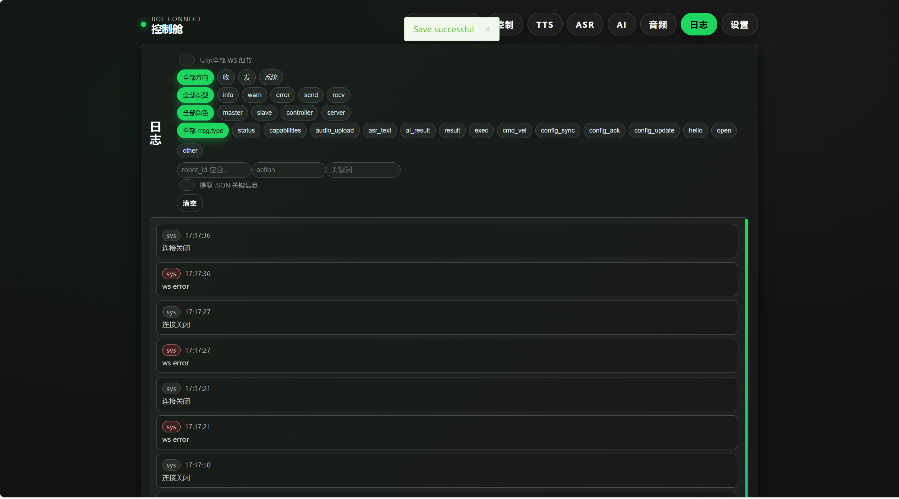
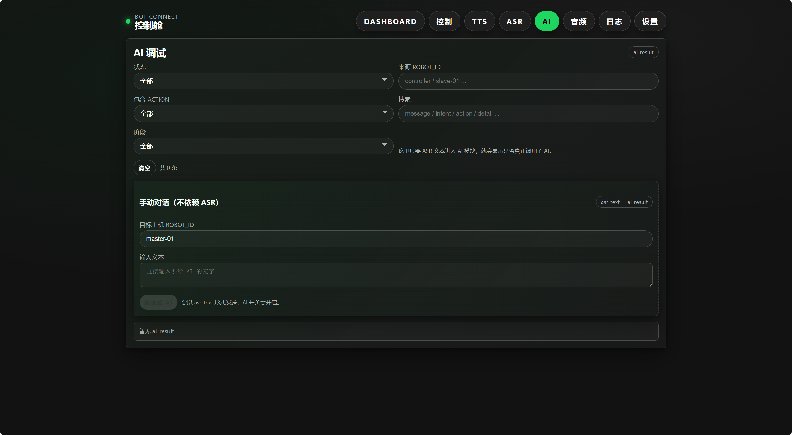
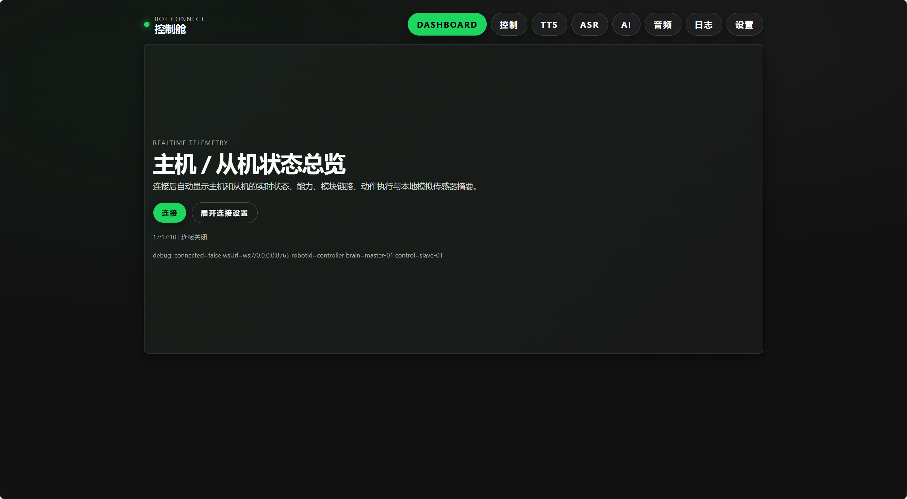

# Bot Connect

Bot Connect 是一个面向机器人控制与协同交互的项目，包含前端控制台、后端消息中转、机器人主从客户端、视觉推理模块和相关文档。

## 项目组成

- `backend/`：Node.js 后端，负责 WebSocket/HTTP、中转消息、配置同步、音频处理。
- `frontend/`：Vue + Vite 控制台，用于控制、监控、设置与调试。
- `common/`：Python 通用模块，例如 WebSocket、动作预设、配置、TTS 封装。
- `master/`：主机端逻辑，负责 ASR、AI、动作路由和结果回传。
- `slave/`：从机端逻辑，负责运动、TTS、视频流和状态回传。
- `robot/`：统一机器人入口，通过 `ROBOT_ROLE=master|slave` 切换角色。
- `vision_yolo/`：独立视觉模块，负责 YOLO 推理、追踪和结果推送。
- `docs/`：项目文档。
- `scripts/`：启动脚本、测试脚本和辅助工具。
- `X2_URDF-v1.3.0/`：机器人 URDF 模型资源。
- `lx2501_3-v0.8.0.9/`：Aima Task SDK 示例与文档。

## 快速启动

### 1. 启动后端

```powershell
cd H:\Project\Bot\bot_connect\backend
npm install
node server.js
```

默认监听 `ws://127.0.0.1:8765`。

### 2. 启动前端

```powershell
cd H:\Project\Bot\bot_connect\frontend
npm install
npm run dev -- --host --port 5173
```

浏览器打开 `http://127.0.0.1:5173`。

### 3. 启动机器人模拟主机

```powershell
cd H:\Project\Bot\bot_connect
.\scripts\start_master_sim.ps1
```

默认会以 `SIM_MODE=1` 启动主机模拟客户端，连接本机后端。

## 常用脚本

- `scripts/start_backend.ps1`：启动后端
- `scripts/start_frontend.ps1`：启动前端
- `scripts/start_full_stack.ps1`：启动后端、前端和主机模拟
- `scripts/start_master_sim.ps1`：仅启动主机模拟
- `scripts/start_slave_win.ps1`：Windows 下的从机模拟
- `scripts/start_slave.sh`：Linux/机器人侧从机启动
- `scripts/start_master.sh`：Linux/机器人侧主机启动

## 文档

- `docs/project/overview.md`：系统总览与架构
- `docs/project/start-manual.md`：启动说明
- `docs/project/pc-deploy.md`：PC 端部署
- `docs/project/robot-deploy.md`：机器人端部署
- `docs/project/monitor.md`：监控页面说明
- `docs/project/actions.md`：动作与控制说明
- `docs/project/motion.md`：运动控制说明
- `docs/project/vision.md`：视觉模块说明
- `docs/project/troubleshooting.md`：常见问题

## 截图建议

建议优先截图这些页面：

1. 前端首页或控制台主界面
2. 监控页的视频流画面
3. 设置页里的 WS / 目标机器人配置
4. 动作控制页或运动控制页
5. 后端终端日志，显示连接成功

## 说明

- 项目中部分配置包含本地网络地址，公开发布前建议检查 `backend/config.json` 和各启动脚本。
- 视觉模型、录制数据和运行日志不建议提交到公开仓库。

## 截图






